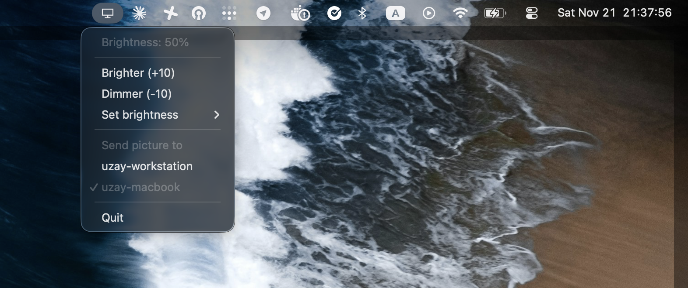

# monctl



Change your monitor's settings from the computer instead of the buttons on the monitor.

`monctl` talks to external monitors over DDC/CI, the control channel that runs on the video cable. It targets Debian with GNOME and macOS with Apple Silicon.

## Install

Packages are on the [GitHub releases page](https://github.com/utkudarilmaz/monctl/releases). You can also [build from source](#build-from-source).

### Debian package

Builds exist for amd64 and arm64.

```sh
sudo apt install ./monctl_<version>_amd64.deb
```

The package installs `/usr/bin/monctl` and the udev rule, so you can skip [Linux setup](#linux-setup). It also installs the docs, the licence texts of the libraries monctl uses, and the [tray service](#run-the-tray-as-a-service) in `/usr/lib/systemd/user/`.

### macOS with Homebrew

Apple Silicon only. Homebrew builds monctl on your Mac, so macOS does not block it. You need the Xcode command line tools.

```sh
brew tap utkudarilmaz/monctl https://github.com/utkudarilmaz/monctl
brew trust utkudarilmaz/monctl
brew install monctl
```

To run the [tray](#tray-menu) at login:

```sh
brew services start monctl
```

### macOS archive

Apple Silicon only. The archive holds the `monctl` binary and a LaunchAgent file for the [tray](#tray-menu).

```sh
tar -xzf monctl_<version>_darwin_arm64.tar.gz
sudo cp monctl_<version>_darwin_arm64/monctl /usr/local/bin/
```

The binary is not signed with an Apple Developer ID, so macOS may block the first start of a downloaded copy. Allow it in System Settings under Privacy and Security. A copy built on the same Mac with `make build` is not affected.

### Build from source

You need Go 1.25 or newer. On macOS, also install the Xcode command line tools, because the macOS part uses cgo with the IOKit framework.

```sh
make build
./bin/monctl version
```

On Linux, then follow [Linux setup](#linux-setup).

#### Linux setup

These steps are only for a build from source. The Debian package does them for you.

monctl needs access to the I2C buses of your graphics card. Install the udev rule from this repo:

```sh
sudo cp packaging/linux/60-monctl.rules /etc/udev/rules.d/
sudo udevadm control -R
sudo udevadm trigger -s i2c-dev
```

monctl prints these commands when it cannot open a bus.

The rule gives the logged in user read and write access to every I2C bus on the graphics card, not only the ones that lead to a monitor. monctl itself only opens buses that belong to a PCI graphics device. It never opens SMBus or other system buses.

## Configuration

### Turn on the tray

Every package brings the tray, but it does not start by itself. Turn it on once, and it starts at every login:

| Install | Run once |
|---|---|
| Debian package | `systemctl --user enable --now monctl-tray.service` |
| Homebrew | `brew services start monctl` |

On GNOME, two extensions are also needed, and the package does not turn them on:

- the AppIndicator extension, so GNOME shows tray icons at all, see [Tray menu](#tray-menu)
- the monctl extension, for the brightness indicator, see [Brightness keys](#gnome)

More about the service is under [Run the tray as a service](#run-the-tray-as-a-service).

### Config file

monctl reads `~/.config/monctl/config.json`, or `$XDG_CONFIG_HOME/monctl/config.json` when that variable is set. The path is the same on Linux and macOS. The file is optional.

```json
{
  "inputs": {
    "dp": { "label": "Desk computer" },
    "usbc": {
      "before": ["ssh", "-o", "BatchMode=yes", "<user>@<other-computer>", "monctl", "wake"]
    },
    "hdmi1": { "hidden": true }
  }
}
```

The keys are the input ids from `monctl input`. Ids the monitor does not have are ignored.

| Setting | What it does |
|---|---|
| `label` | The name shown for the input. You can use it as a name: `monctl input "Desk computer"`. |
| `hidden` | Leaves the input out of the list. It still works by its id. |
| `before` | A command monctl runs before it switches to the input, for example to wake the other computer. |

### Run a command before a switch

`before` is a command monctl runs before it switches the monitor to that input. Write the program and each argument as its own word, because no shell is used. If the command fails or takes longer than 20 seconds, monctl prints a warning and switches anyway. It runs for `monctl input <name>` and for the tray, not for `monctl input -raw`.

Use it to wake the other computer first. Say computers A and B can reach each other over SSH with keys, with no password prompt, and both have monctl installed. On A, give the input that leads to B this setting:

```json
{
  "inputs": {
    "usbc": {
      "before": ["ssh", "-o", "BatchMode=yes", "<user>@<computer-b>", "monctl", "wake"]
    }
  }
}
```

Put the user name and the host name of B in place of `<user>` and `<computer-b>`. Do the same on B for the input that leads to A. If monctl is not on the PATH of the other computer, use its full path, for example `/usr/local/bin/monctl`.

Only the config file can hold a `before` command, not a monitor profile. Because it can start programs, make the file writable only by you.

To add or override a monitor profile, put it in `~/.config/monctl/profiles/*.json`. Your profiles win over the ones shipped with monctl.

## Usage

```sh
monctl list
```

```text
ID                 NAME           CONNECTOR  BUS         PROFILE
msi-3cf0-ab12cd34  MPG 274U E16M  DP-1       /dev/i2c-5  MSI MPG 274URDFW E16M
```

`list` shows the external monitors monctl can reach. The ID is the maker, the product code, and the serial number from the monitor. On macOS, CONNECTOR shows `-` and BUS shows the display service, for example `avservice:4295167419`.

```sh
monctl brightness        # print the brightness
monctl brightness 40     # set it to 40
monctl brightness +10    # raise it by 10
monctl brightness -10    # lower it by 10
```

Brightness stays between 0 and the monitor's maximum. Each command prints the new value.

```sh
monctl input             # print the current input and the inputs you can switch to
monctl input usbc        # switch to USB-C
```

```text
Current: DisplayPort (dp)
Inputs:
  dp    DisplayPort
  usbc  USB-C
```

```sh
monctl wake              # turn on the screen of this computer
```

`wake` takes no flags. It first prints `computer: <name>` with the name of this computer, which the computer that asked uses as the input name. On GNOME it needs this user to be logged in at the screen. On macOS it works like moving the mouse. It is meant to be run from another computer before a switch, see [Configuration](#configuration).

Add `-json` to `list`, `brightness`, `input`, or `probe` for JSON output. With more than one monitor, pick one with `-d`:

```sh
monctl list -json
monctl brightness 40 -d msi-3cf0-ab12cd34
```

`monctl probe` prints what a monitor reports. It helps add a new model, see [CONTRIBUTING.md](CONTRIBUTING.md#adding-a-monitor). Run `monctl` alone for the full command list.

## Tray menu

The tray is optional. The other commands work without it.

```sh
monctl tray              # show the menu until you pick Quit
monctl tray -d msi-3cf0-ab12cd34
```

```text
Brightness: 60%

Brighter (+10)
Dimmer (-10)
Set brightness   >  0%  25%  50%  75%  100%

Send picture to
  [x] Desk computer
  [ ] Laptop

Quit
```

The inputs come from the monitor profile and use your labels from the config. The menu reads the monitor each time you open it. When the monitor shows another computer, the menu says so and its actions are greyed out. Errors go to the terminal that started `monctl tray`.

GNOME shows no tray icons by default. Install the AppIndicator extension, then log out and in:

```sh
sudo apt install gnome-shell-extension-appindicator
gnome-extensions enable ubuntu-appindicators@ubuntu.com
```

`monctl tray` prints these steps when the extension is missing. macOS needs no setup.

### Run the tray as a service

The tray does not start at login by default. As a service, it starts at login and restarts after a crash. Picking Quit stops it until the next login.

On Linux, the Debian package installs a systemd user service. Turn it on:

```sh
systemctl --user enable --now monctl-tray.service
```

It starts with the graphical session. After 5 failed starts in a minute, it gives up. On GNOME it still needs the AppIndicator extension. Without it the service fails, and the status shows the install steps.

```sh
systemctl --user status monctl-tray.service    # see its state
journalctl --user -u monctl-tray.service       # see its messages
systemctl --user disable --now monctl-tray.service   # turn it off
```

For a build from source, copy `packaging/linux/monctl-tray.service` to `~/.config/systemd/user/`. If monctl is not in `/usr/bin`, change the `ExecStart` path in the copy.

On macOS, copy monctl to `/usr/local/bin/`. Then run this from the unpacked archive and log in again:

```sh
cp packaging/io.github.utkudarilmaz.monctl.tray.plist ~/Library/LaunchAgents/
```

To start it now without logging out, and to stop and remove it:

```sh
launchctl bootstrap gui/$(id -u) ~/Library/LaunchAgents/io.github.utkudarilmaz.monctl.tray.plist
launchctl bootout gui/$(id -u)/io.github.utkudarilmaz.monctl.tray
```

## Brightness keys

The brightness keys of your keyboard can change the external monitor. On macOS this needs the [tray](#tray-menu) to be running. On GNOME the keys work without it, but the tray makes them faster and shows the indicator. The tray remembers the brightness, so a key press costs one short write, and quick presses or a held key are merged.

### macOS

The tray catches the brightness keys itself. One press moves the brightness by 5 percent and shows the system brightness indicator on the monitor. While the monitor shows another computer, the keys keep their normal job.

macOS has to allow this once. At the first start it asks for the Accessibility permission. Open System Settings, Privacy and Security, Accessibility, turn monctl on, and start the tray again:

```sh
brew services restart monctl
```

monctl is not signed with an Apple Developer ID, so macOS drops the permission after each upgrade. Turn it on again the same way. Other apps that catch the same keys, such as MonitorControl, should not run at the same time.

The brightness slider in System Settings only works for Apple displays. monctl cannot change that.

### GNOME

Bind the keys to monctl in Settings, Keyboard, View and Customise Shortcuts, Custom Shortcuts:

| Name | Command | Shortcut |
|---|---|---|
| monctl brighter | `monctl brightness +5` | the brightness up key |
| monctl dimmer | `monctl brightness -5` | the brightness down key |

GNOME does not let a normal program show its on-screen indicator, so the Debian package ships a small GNOME Shell extension that does it for monctl. Log out and in once after installing the package, then turn it on:

```sh
gnome-extensions enable monctl@utkudarilmaz.github.io
```

The indicator shows when the tray changes the brightness, which covers the shortcuts above. Without the extension everything else still works. Installed from the archive, copy `packaging/gnome-extension` to `~/.local/share/gnome-shell/extensions/monctl@utkudarilmaz.github.io` first.

While the tray runs, `monctl brightness` with a value hands the change to the tray, which is about ten times faster than doing it alone. Without the tray the command still works.

## How input switching behaves

- A monitor only answers on the input it is showing. A computer can send the picture to another computer, but it cannot pull it back.
- When the monitor shows another computer, monctl says so.
- The target computer must be awake and sending a picture. If its screen is asleep, the monitor finds no picture and falls back to the old input. With the monitor's automatic input scan turned off, it stays black instead. A laptop with a closed lid may go to sleep when the picture leaves it.
- To fix this, wake the target computer first with a [`before` command](#configuration). In tests, switches with this step worked every time, also onto a blanked screen and onto a laptop with a closed lid.
- monctl watches the monitor for about 14 seconds after a switch. If the monitor comes back, monctl switches again, up to three times. A first try can wake the other computer through the cable, for example at its login screen, so the second try often works. `monctl input <name>` returns only after this check.
- Leave the monitor's automatic input scan on, so a failed switch falls back to a picture instead of a black screen.
- Only one monctl command talks to the monitor at a time. Others wait for their turn, so quick key presses that run `monctl brightness +10` add up in order.
- After a switch, the monitor needs around ten seconds before it answers again.

## Supported monitors

| Monitor | Brightness | Input switching |
|---|---|---|
| MSI MPG 274URDFW E16M | yes | DisplayPort and USB-C. HDMI values are not measured yet. |

On macOS, this monitor is tested over USB-C.

Other monitors are added through small profile files. See [CONTRIBUTING.md](CONTRIBUTING.md#adding-a-monitor).

## Development

```sh
make ci
```

`make ci` runs every check the CI workflow runs: dependency check, lint, tests, build, and `make package`. `make package` writes `dist/monctl_<version>_<os>_<arch>.tar.gz`, and on Linux also `dist/monctl_<version>_<arch>.deb`. The workflow only calls `make` targets, so a failure in CI can be reproduced on your machine with the same command. Run `make` alone to list all targets.

## License

[MIT](LICENSE)

The tray uses [fyne.io/systray](https://github.com/fyne-io/systray) (Apache-2.0) and [godbus/dbus](https://github.com/godbus/dbus) (BSD-2-Clause).
